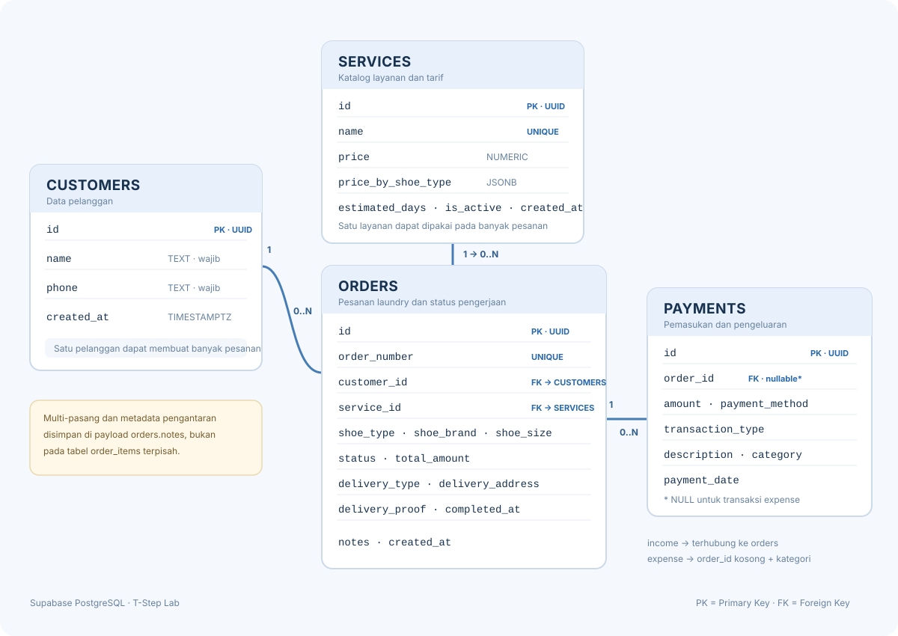

# T-Step Lab — Sistem Kas Laundry Sepatu

Aplikasi web sederhana untuk mengelola operasional laundry sepatu: pencatatan pesanan, antrean pengerjaan, pembayaran, buku kas, dan jurnal umum. Frontend dibuat dengan HTML, CSS, dan JavaScript; backend menggunakan Node.js; penyimpanan data menggunakan Supabase dengan PostgreSQL.

## Fitur

- Login terpisah untuk Admin dan Owner.
- Pencatatan pesanan untuk satu atau beberapa pasang sepatu, termasuk layanan, jenis/bahan, merek, dan ukuran per pasang.
- Antrean dan pembaruan status pengerjaan hingga pengantaran.
- Perhitungan tarif serta status pembayaran pesanan.
- Buku kas untuk pemasukan pembayaran dan pengeluaran operasional.
- Jurnal umum yang dibentuk dari transaksi.
- Pengaturan katalog layanan dan tarif berdasarkan jenis sepatu.
- Opsi pelanggan mengantar sepatu ke toko, meminta jemput-antar, atau meminta pengantaran setelah pesanan siap.

### Aturan pembayaran dan pengantaran

- Sepatu yang diantar pelanggan ke toko: pembayaran awal minimal 70% dari tarif setiap pasang.
- Permintaan antar oleh karyawan: biaya tetap Rp5.000 per pesanan, bukan per pasang.
- Layanan jemput dari rumah dan antar kembali oleh karyawan: pembayaran harus lunas 100% sebelum penjemputan.
- Permintaan antar setelah pesanan siap dikenai tambahan Rp5.000. Sisa tagihan termasuk biaya antar harus dibayar lunas melalui QRIS sebelum status pengantaran dapat dimulai.

## Teknologi

- **Frontend:** HTML, CSS, JavaScript
- **Backend:** Node.js (modul bawaan; tidak memerlukan `package.json`)
- **Database:** Supabase PostgreSQL
- **Diagram ERD:** SVG, ditampilkan langsung di bawah

## ERD (Entity Relationship Diagram)

Diagram berikut menggambarkan empat tabel utama yang benar-benar diterapkan pada PostgreSQL. Diagram disertakan sebagai SVG agar tampil langsung pada README GitHub.



**Ringkasan relasi:** satu pelanggan dapat memiliki banyak pesanan; satu layanan dapat menjadi layanan utama pada banyak pesanan; satu pesanan dapat memiliki banyak pembayaran. Pengeluaran operasional juga tersimpan pada `payments`, dengan `order_id` kosong dan tipe transaksi `expense`.

> **Catatan model multi-pasang:** ERD di atas menampilkan tabel fisik yang ada. Rincian beberapa pasang sepatu serta metadata logistik disimpan aplikasi dalam payload pada `orders.notes`, bukan pada tabel `order_items` terpisah. Struktur SQL lengkap tersedia di [`backend/schema.sql`](backend/schema.sql).

## Struktur folder

```text
T-Step-Lab-App/
├── backend/
│   ├── app.js                 # Server HTTP dan API
│   ├── schema.sql             # Skema PostgreSQL untuk Supabase
│   └── .env                   # Konfigurasi lokal; jangan unggah ke GitHub
├── frontend/
│   ├── index.html
│   ├── app.js
│   └── styles.css
├── ERD.svg                    # Diagram relasi basis data
├── Buka T-Step Lab.bat        # Menjalankan server dan membuka browser di Windows
└── README.md
```

## Persiapan

1. Pasang Node.js LTS pada komputer.
2. Buat atau pilih project di [Supabase](https://supabase.com/).
3. Buka **Supabase Dashboard → SQL Editor**, lalu jalankan seluruh isi [`backend/schema.sql`](backend/schema.sql).
4. Buat file lokal `backend/.env` dengan konfigurasi berikut:

   ```dotenv
   SUPABASE_URL=https://YOUR_PROJECT_ID.supabase.co
   SUPABASE_SECRET_KEY=YOUR_SUPABASE_SECRET_KEY
   PORT=3000
   ```

   Gunakan **Secret key** Supabase (atau `service_role` key lama) di backend. Jangan gunakan key rahasia pada frontend, jangan menaruh nilainya di README, dan jangan commit file `.env`.

5. Jalankan aplikasi:
   - **Windows:** klik dua kali `Buka T-Step Lab.bat`.
   - **Terminal:** dari folder proyek, jalankan `node backend\app.js`.
6. Buka [http://localhost:3000](http://localhost:3000).

Backend juga mengenali variabel `SUPABASE_SERVICE_ROLE_KEY`. `SUPABASE_URL` dan `PORT` bersifat opsional pada konfigurasi lokal, tetapi sebaiknya URL project Supabase diatur eksplisit agar aplikasi terhubung ke project yang benar.

## Akun aplikasi

Akun demo Admin dan Owner saat ini didefinisikan pada backend. Untuk penggunaan lokal, periksa bagian `accounts` di [`backend/app.js`](backend/app.js). **Sebelum mengunggah kode secara publik atau menerapkannya untuk penggunaan nyata, ganti akun demo dan jangan gunakan kredensial bawaan.** Implementasi autentikasi ini ditujukan untuk demonstrasi, bukan sebagai sistem autentikasi produksi.

## Dokumentasi skema dan ERD

Skema PostgreSQL lengkap untuk tabel `customers`, `services`, `orders`, dan `payments`, termasuk constraint, indeks, serta fungsi RPC tersedia di:

- [SQL skema Supabase](backend/schema.sql)

**Catatan model:** detail beberapa pasang sepatu dan sebagian metadata pengantaran saat ini disimpan dalam metadata terenkode di `orders.notes`, bukan sebagai tabel `order_items` terpisah. Karena itu, ERD menggambarkan relasi tabel yang benar-benar ada di database, bukan struktur internal payload tersebut.

## Keamanan sebelum publikasi

- Pastikan `backend/.env` dan file konfigurasi lokal tidak masuk ke commit.
- Jangan menaruh Supabase Secret/service-role key di frontend, README, screenshot, atau riwayat commit.
- Ganti akun demo yang didefinisikan di backend sebelum publikasi atau deployment. Untuk produksi, gunakan autentikasi yang sesuai, penyimpanan password yang di-hash, HTTPS, dan pengelolaan secret di lingkungan server.
- RLS aktif pada tabel Supabase. Aplikasi mengakses basis data melalui backend; jangan memberikan akses key server kepada browser.

## Pengembangan

Frontend disajikan langsung oleh server Node.js dari folder `frontend`. Perubahan antarmuka dapat diuji dengan memuat ulang browser. Perubahan backend memerlukan server dimulai ulang. Pemeriksaan sintaks JavaScript dapat dijalankan dengan:

```text
node --check frontend\app.js
node --check backend\app.js
```
